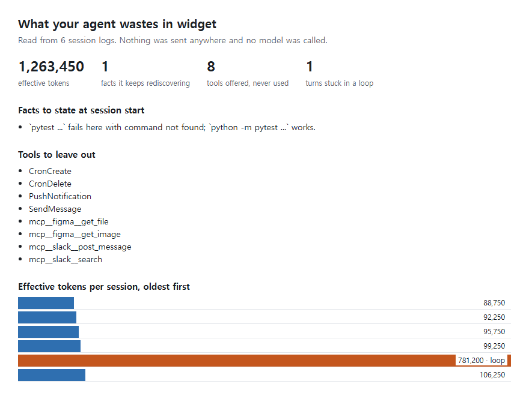

<div align="center">

# token-tightwad

**Break your coding agent's stuck loops, prune tools it never uses and stop repeated mistakes, with no model calls.**

The three ideas behind Microsoft's [TokenEconomizer](https://github.com/microsoft/TokenEconomizer), rebuilt as one Python file that reads the logs your agent already keeps and never spends a token itself.

Works with **Claude Code** and **Codex**.

  



</div>

## Quick start

No logs needed for the demo. It builds six made-up sessions:

```bash
git clone https://github.com/Dodai0419/token-tightwad && cd token-tightwad
python tightwad.py --demo
```

```text
widget: 6 sessions, 6 prompts, 49 tool calls, 1,263,450 effective tokens

Facts it keeps rediscovering (1 active, 0 still collecting evidence):
  `pytest ...` fails here with command not found; `python -m pytest ...` works.

Tools offered and never used here (8, at least 34 tokens per request if each costs only its listing line):
  CronCreate, CronDelete, PushNotification, SendMessage, mcp__figma__get_file, mcp__figma__get_image, mcp__slack__post_message, mcp__slack__search

Turns the loop guard would have stepped into: 1 across 1 sessions
```

On a repo you already work in. This only reads:

```bash
python tightwad.py report --repo /path/to/your/repo --html report.html
```

## Install in Claude Code / Codex

```bash
/plugin marketplace add Dodai0419/token-tightwad
/plugin install token-tightwad@token-tightwad
```

The plugin turns on two hooks: known facts at the start of a session, and the loop guard during a turn. Tool pruning stays off until you run `prune --apply`.

```bash
git clone https://github.com/Dodai0419/token-tightwad && cp -r token-tightwad/skills/* ~/.codex/skills/
```

Then ask: *"Run token-tightwad on this repo and show me what we keep wasting. Change nothing yet."*

## The problem

- Your agent starts every session knowing nothing. It tries `pytest`, gets `command not found`, and works out `python -m pytest` again, in every session.
- Every loaded tool is listed in every request, and you pay for that whether or not this repo ever uses it.
- A stuck turn keeps editing and rerunning the same failing test, and each try re-reads the whole conversation.

## The solution

| Idea | Fixes |
|------|-------|
| **Facts from repeated failures** | The same failure and the same repair in three sessions becomes one line at the start of the next session. |
| **Prune from evidence** | A tool unused over 10 prompts in 2 sessions, or over 5 sessions, is proposed for a `permissions.deny` rule. Work tools and the web never are. |
| **Loop guard with no judge** | Churn, errors and the same failure repeating, together, send the agent one redirect. A hard but productive grind is left alone. |
| **No model calls** | It reads local logs and writes local files, so the tool cannot add to your bill. |
| **One command undoes it** | `prune --restore` takes back exactly what it added, never a rule you wrote. |

## What each part does

### Facts

```bash
python tightwad.py facts --repo .
```

```text
# environment facts learned from earlier sessions in this repository
- `pytest ...` fails here with command not found; `python -m pytest ...` works.
```

With the plugin, Claude Code gets this block at session start. For Codex, or without the plugin, put it in a file the agent reads. Only the part between its own markers is replaced:

```bash
python tightwad.py facts --repo . --agent codex --write AGENTS.md
```

A fact is dropped when the failing form starts working, for example after you install `pytest`. One contradiction weighs as much as five confirmations.

### Tools

```bash
python tightwad.py prune --repo .
```

```text
8 tools never used here:
  CronCreate
  CronDelete
  PushNotification
  SendMessage
  mcp__figma__get_file
  mcp__figma__get_image
  mcp__slack__post_message
  mcp__slack__search

Dry run. Pass --apply to write them.
```

```bash
python tightwad.py prune --repo . --apply
python tightwad.py prune --repo . --restore
```

`--apply` writes to `.claude/settings.local.json` and adds what it created to `.git/info/exclude`, so it cannot be committed by accident. It applies from the next session.

### The loop guard

With the plugin on, a turn that is stuck gets this as added context, once:

```text
Process check (automated): so far you've made 10 edits across 1 file(s) (most to `app.py`) and run 10 verification(s), and the same failure has recurred 9 time(s) without the tests going green. This looks like a repetitive loop. Do NOT stop. Instead step back and try a MATERIALLY DIFFERENT hypothesis: re-read the failing test's expectation, consider a different file or root cause than the ones you've been editing, and verify the new hypothesis directly before editing again.
```

If it is still stuck 10 tool calls later, you get one notice saying you can press Esc. It never stops a turn itself. Each new prompt starts the count over.

## Examples

### See what one repo costs per session

```bash
python tightwad.py report --repo ~/code/api --html api.html
```

Effective tokens count each token by what it is billed at: a cached re-read is 0.1, a cache write 1.25 and an output token 5 on Claude. A million raw tokens of cached re-reads are worth 100,000 here.

### Check Codex sessions

```bash
python tightwad.py report --repo . --agent codex
```

### Try a cold repo

```text
No claude sessions found for /path/to/repo. Run this from a repo you have worked in with the agent, or pass --repo.
```

### Keep broken settings safe

If `.claude/settings.local.json` is not valid JSON, `--apply` stops and changes nothing:

```text
.claude/settings.local.json is not valid JSON, so nothing was changed
```

## How facts stay honest

These rules exist because the first version, run on real logs, learned nonsense.

| A false fact would come from | The rule that stops it |
|---|---|
| A different `cd somewhere && python` after each failure | The same failing and working pair must appear in 3 sessions |
| A successful test whose output says "command not found" | Output is only read as failure when the command failed or was piped |
| `pytest && make build` failing | A failed compound command counts as no evidence, as its output does not say which part failed |
| `pytest --nope` | A usage error in a test run is a typo, not a fact about the repo |
| A filtered test run, `pytest \| grep FAILED`, that printed nothing | A test run only "worked" if the output shows tests ran |

Run read-only over the 234 real Claude Code sessions on the author's machine (10,866 tool calls), the finished rules produced 0 active facts, 502 candidates and 1 retired fact. The earlier rules had produced 2 false facts on the same logs. The guard would have stepped into 24 turns. That run shows the rules do not invent facts. It does not show they save money.

## Why this instead of TokenEconomizer

| | [TokenEconomizer](https://github.com/microsoft/TokenEconomizer) | token-tightwad |
|---|---|---|
| Facts from repeated failures | yes, 5 families | 1 family: form repair |
| Facts proposed by a model reading sessions | **yes** | **no** |
| Tool pruning on Claude Code | yes, same rule | yes |
| Tool pruning on Codex and Copilot | **yes** | **no** |
| Loop guard | a model judges each candidate, and the redirect is written by a model | fixed rule, fixed text |
| Measured savings | **yes: 18.4-30.9% on SWE-Bench, in its paper** | **none measured** |
| Agents | Claude Code, Codex, Copilot, Pi, 3 experimental | Claude Code; Codex for reports and facts only |
| Model calls it makes | fact proposer and judge, through your agent, and counted in its reports | 0 |
| Setup | clone, install plugin, trust hooks | one file |

If you want the method with evidence behind it, use TokenEconomizer. It is the better tool, and its measured savings are its own. They were not reproduced here, and this repo has fewer mechanisms, so do not expect the same numbers. Use token-tightwad to see what a repo wastes in a minute, or when you want nothing added to your bill.

## Benchmarks

| | TokenEconomizer | token-tightwad |
|---|---|---|
| Lines of Python, excluding tests and experiments | 15,496 | 643 |
| Python packages | 0 | 0 |
| Model calls made by the tool | some, on by default for the loop guard | 0 |
| Read and report on one real session log, best of 3 | not measured | 0.18 s (19 MB, 122 tool calls), 0.45 s (7 MB, about 130 calls), 2.5 s (56 MB, 2,458 calls) |
| Tests | not measured | 54 tests, 1-4 s |

Machine: Windows 11, Python 3.11. Time follows the tool call count more than the file size, and a busy machine can double it. Commands: `python tightwad.py report --repo REPO` and `python -m unittest discover -s tests`. TokenEconomizer was not run for this table: this build's permission policy blocks running cloned code. Its line count comes from `git ls-files`, and its rules were ported by reading its source.

## Limits

- **No savings figure.** It shows waste and removes some of it. How much you save was not measured.
- **Pruning may save little.** Claude Code's logs only name deferred tools. They cost about one listing line each rather than a full schema, which is why the report says "at least" a small number of tokens. Upstream's source makes the same point. Tools with full schemas are not always visible in a log.
- **The fixed rule misses loops** that a model would catch, and could step into a turn that a model would spare. It needs 20 tool calls before it acts.
- **Not tried on a real Codex log.** No Codex is installed where this was built. The rollout reader follows upstream's parser and a fixture in that shape.
- Codex has no pruning or hooks here, only `report` and `facts`.
- The hooks were tested with recorded-shape JSON events through `python tightwad.py hook`, not inside a live Claude Code session.
- On macOS and some Linux installs, `python` may need to be `python3` in `hooks/hooks.json`.

## Inspired by

- [microsoft/TokenEconomizer](https://github.com/microsoft/TokenEconomizer) (Apache-2.0): the three mechanisms, their thresholds and lifecycle constants, the loop guard's signals and redirect text, the error classes and the price ratios.

## Roadmap

- [ ] Before and after: effective tokens per session once facts and pruning are on
- [ ] The boundary family of facts: hosts that are always refused here
- [ ] Try the Codex reader on real rollouts

## License

Apache-2.0. See [LICENSE](LICENSE) and [NOTICE](NOTICE). This is not a Microsoft product.
